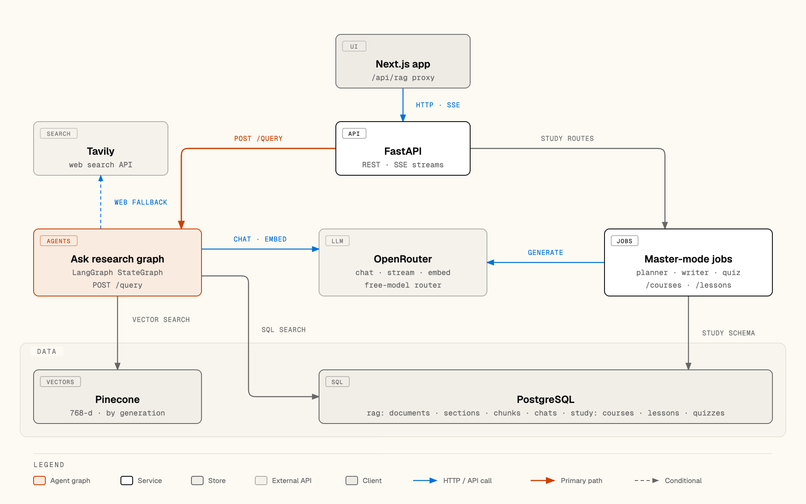
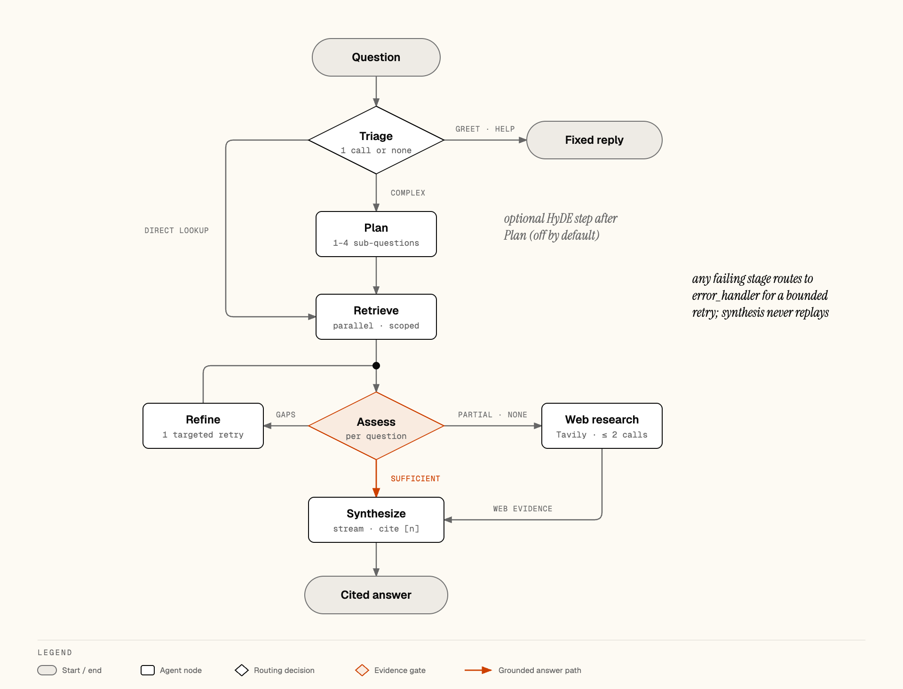
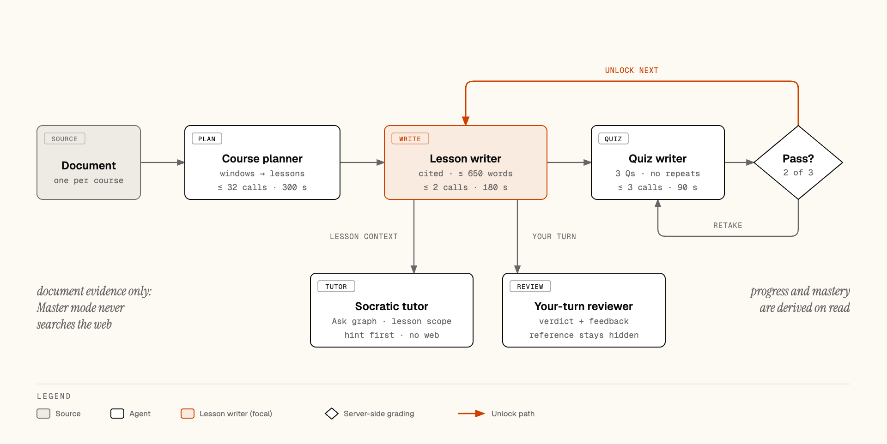
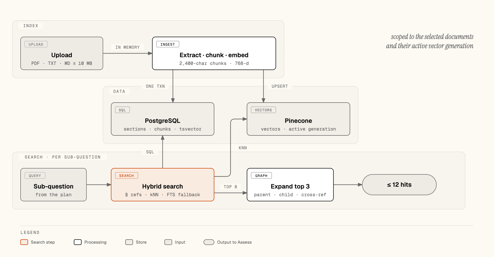
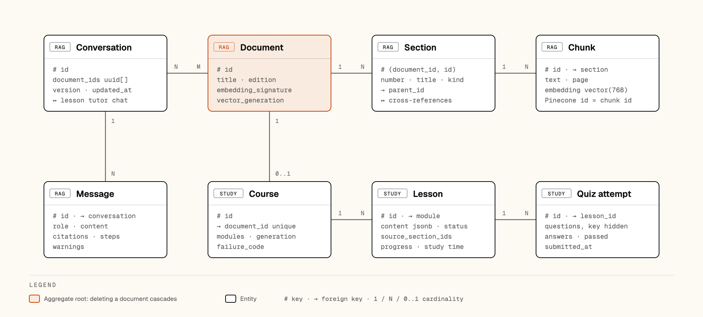
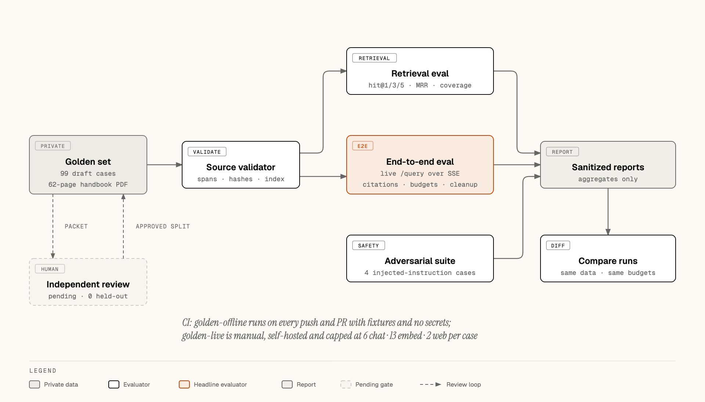

# Learn.si

Understand what you read, Remember what you learn. 
**Ask mode** answers questions with cited evidence and document/web research. 
**Master mode** learn with courses, lesson plan with a tutor agent and quizzes/exercises that unlock the next lesson.

**Stack:** Python 3.12, FastAPI, LangGraph, Pydantic · PostgreSQL, Pinecone · Next.js · pytest, Playwright, GitHub Actions.

## Architecture

### 1. System overview

[](docs/images/system-architecture.png?raw=true)

### 2. Agentic architecture

#### Ask mode research graph

[](docs/images/ask-graph.png?raw=true)

| Agent | Decides or produces |
| --- | --- |
| Triage | Fixed reply for greetings and help (no model call), direct retrieval for explicit references and single facts, planning for complex questions |
| Plan | 1–4 validated sub-questions with dependencies; an invalid plan falls back to the original question |
| Retrieve | Hybrid search per sub-question, run in dependency waves (2 workers by default) |
| Assess | `sufficient`, `partial` or `none` per sub-question; supporting chunk IDs must come from that question's evidence |
| Refine | One targeted re-search for the gaps, then re-assessment |
| Web research | At most 2 Tavily calls, assessed separately from document evidence |
| Synthesize | Streams *From your documents* and *From the web* sections; citation numbers are validated before the turn is saved |

#### Master mode agents

[](docs/images/master-mode.png?raw=true)

- The planner, lesson writer and quiz writer validate their output against schemas and retry once, then fail with a reason (`ungrounded`, `invalid`, `budget`, `timeout`) rather than invent material.
- Quizzes are graded on the server. Options are shuffled, the question type rotates (recall, apply, analyze) and retakes avoid repeating earlier questions.
- The tutor is the Ask research graph scoped to one lesson: that lesson's sections rank first, web search is off, and it gives a hint before the answer.

### 3. Retrieval and indexing

[](docs/images/retrieval.png?raw=true)

- Uploads are processed in memory. A document's sections and chunks are replaced in one transaction, and its vectors are written under a new generation; superseded vectors are cleaned up from a journal.
- Each query takes exact section and table references, adds kNN hits hydrated from SQL (full-text search if embedding fails), keeps the top 8, then expands the top 3 to parent, child and cross-referenced sections.

### 4. Data model

[](docs/images/data-model.png?raw=true)

- `rag` schema: documents, sections (hierarchy and cross-references), chunks (vector and `tsvector`), conversations and messages, plus a vector-cleanup journal and deletion tombstones.
- `study` schema: courses, modules, lessons, progress, quiz and *Your turn* attempts, and lesson-bound tutor chats. Deleting a document cascades to its course; deleting a course never touches the document.

## Evals

[](docs/images/evals.png?raw=true)

| Suite | Measures | Latest recorded result |
| --- | --- | --- |
| Retrieval | hit@k, MRR and evidence coverage on 88 development cases | hit@1 0.51 · hit@3 0.70 · hit@5 0.81 · MRR 0.62 |
| End-to-end | SSE contract, citation identity and placement, budgets, persistence, cleanup | 8 / 8 pilot cases pass · p50 10.5 s · p95 20.2 s |
| Adversarial | Instructions injected into retrieved text | 4 / 4 synthetic cases pass |
| Evidence assessment | Sufficiency verdicts on 12 fixed cases | 12 / 12 correct · 0 false "sufficient" |
| Concurrency | Research worker scheduling (offline benchmark) | 1.99× faster with 2 workers · 2.50× with 4 |

## Frameworks

| Framework | Role |
| --- | --- |
| LangGraph | `StateGraph` with conditional edges and an explicit `error_handler` node; no checkpointer, because PostgreSQL owns persistence |
| FastAPI | REST and SSE API, lifespan cleanup loops, in-process job registry for Master mode |
| Pydantic | Schemas for every model output (strict for the Ask agents) and for settings |
| psycopg 3 | Async pooled PostgreSQL: transactions, row locks, optimistic versions |
| httpx | OpenRouter, Pinecone and Tavily clients with timeouts and streaming |
| pytest, Playwright | Unit, integration and golden-eval tests; fixture-backed browser suite in CI |

## Development setup

Requires Python 3.11+, [uv](https://docs.astral.sh/uv/), PostgreSQL with pgvector, and an OpenRouter key. Pinecone (set `VECTOR_BACKEND=pgvector` to skip it) and Tavily are optional.

```sh
uv sync --python 3.12
cp .env.example .env                  # set DATABASE_URL and OPENROUTER_API_KEY
uv run python -m scripts.migrate      # applies migrations/*.sql in order
uv run python -m scripts.ingest examples/demo.json
uv run uvicorn server:app --port 8001
uv run pytest -q                      # providers mocked; no model credits
```

The web app in `web/` (`npm ci && npm run dev`) proxies to the API at `http://127.0.0.1:8001`.
